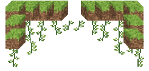
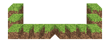

  

  

  

  
   
  <em>Experience with Frontend and Backend technologies, building complete web and mobile applications, IoT solutions, and providing technical support for systems.</em>

  
   
  <em>Currently working as a Salesforce Developer, building and maintaining scalable solutions on the Salesforce platform, focusing on customization, integrations, and business-driven solutions.</em>

  
   
  <em>Technical education in Systems Development, with an emphasis on programming, technological solution development, and IT support services.</em>

  
   
  <em>Degree in Systems Analysis and Development, focusing on computational systems, software architecture, IoT solutions, and IT support. (in progress)</em>

  <h1 align="center" style="color: #E5B5FF;">Studying</h1>

  
  
  
  
  
  
  
  
  
  
  
  
  
  

  

  <h1 align="center" style="color: #E5B5FF;">Contact</h1>

 

  

