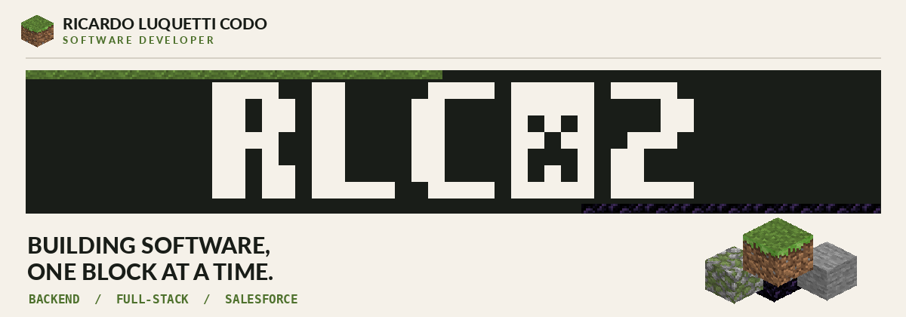
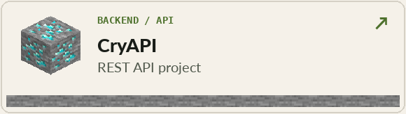
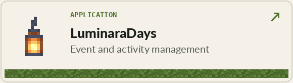
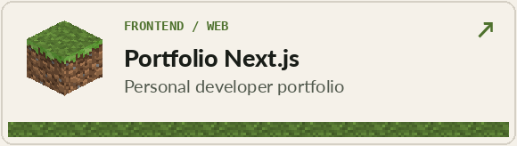
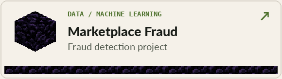

  

  <a href="#featured-projects">Projects</a> &nbsp;·&nbsp;
  <a href="#experience">Experience</a> &nbsp;·&nbsp;
  <a href="#technology-stack">Tech stack</a> &nbsp;·&nbsp;
  <a href="https://www.linkedin.com/in/ricardo-luquetti-codo-835a5125b">LinkedIn ↗</a>

## About me

Software developer with experience in frontend and backend development, web and mobile applications, IoT solutions, and technical support. I work with Salesforce customization, integrations, and business-driven solutions at IBM.

<strong>Reliable systems · Practical solutions · Continuous learning</strong>

## Featured projects

  
  
   
  
  

<a href="https://github.com/RLC02?tab=repositories">View all repositories ↗</a>

## Experience

**IBM Consulting** · Salesforce Developer Intern  
Salesforce development, platform customization, integrations, system maintenance and technical support.

## Education

**FATEC Zona Leste** · Systems Analysis and Development (in progress)  
**ETEC Zona Leste** · Technical education in Systems Development

## Technology stack

Technologies I work with or am currently studying.

**Salesforce**

   

**Backend**

      

**Frontend & mobile**

    

**Systems & IoT**

 

## Contact

Interested in backend, full-stack, Salesforce and systems integration opportunities.

[**Connect on LinkedIn ↗**](https://www.linkedin.com/in/ricardo-luquetti-codo-835a5125b)

Independent personal portfolio. Minecraft-inspired design using original Minecraft Java Edition 1.21.4 textures, sourced from <a href="https://github.com/InventivetalentDev/minecraft-assets/tree/1.21.4">MC Assets</a>. Minecraft belongs to Mojang and Microsoft. Not an official Minecraft product.
