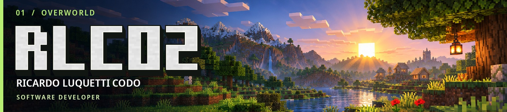
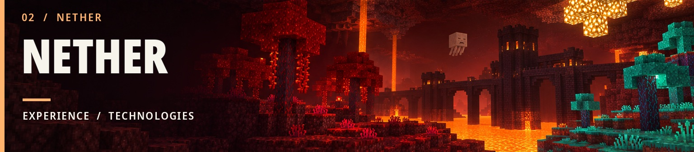
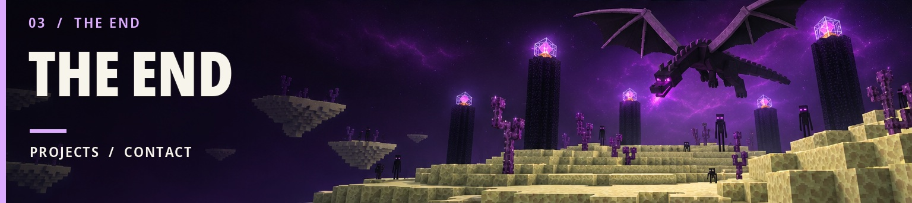

  

  <a href="#overworld--about">About</a> &nbsp; / &nbsp;
  <a href="#nether--experience">Experience</a> &nbsp; / &nbsp;
  <a href="#the-end--selected-projects">Projects</a> &nbsp; / &nbsp;
  <a href="https://www.linkedin.com/in/ricardo-luquetti-codo-835a5125b">LinkedIn ↗</a>

## Overworld — About

**Building reliable software, one block at a time.**

I'm a software developer with experience in frontend and backend development, web and mobile applications, IoT solutions, and technical support. My work focuses on building practical, maintainable systems, with an emphasis on Salesforce, integrations and full-stack development.

| Education | Focus |
| :--- | :--- |
| **FATEC Zona Leste** | Systems Analysis and Development · In progress |
| **ETEC Zona Leste** | Technical education in Systems Development |

 

## Nether — Experience

**IBM Consulting** · Salesforce Developer Intern

Salesforce development and administration, platform customization, system integrations, troubleshooting and technical support for business-driven solutions.

### Technology stack

Technologies I work with or am currently studying.

**Salesforce**  
  

**Backend**  
     

**Frontend & mobile**  
   

**Systems & IoT**  

 

## The End — Selected projects

| Project | Description |
| :--- | :--- |
| [**CryAPI ↗**](https://github.com/RLC02/CryAPI) | REST API project |
| [**LuminaraDays ↗**](https://github.com/RLC02/LuminaraDays) | Application project |
| [**Portfolio Next.js ↗**](https://github.com/RLC02/portifolio-nextjs) | Personal developer portfolio |
| [**Marketplace Fraud Detection ↗**](https://github.com/RLC02/marketplace-fraud-detection) | Fraud detection project |

[Explore all repositories →](https://github.com/RLC02?tab=repositories)

### Let's connect

Interested in opportunities involving backend, full-stack development, Salesforce and system integrations.

---

Independent personal portfolio · Minecraft-inspired fan artwork. Not affiliated with Mojang or Microsoft. Minecraft belongs to its respective owners. Stone texture sourced from <a href="https://github.com/InventivetalentDev/minecraft-assets/tree/1.21.4">MC Assets (Java 1.21.4)</a>. Landscape artwork is AI-generated and is not official game art.

